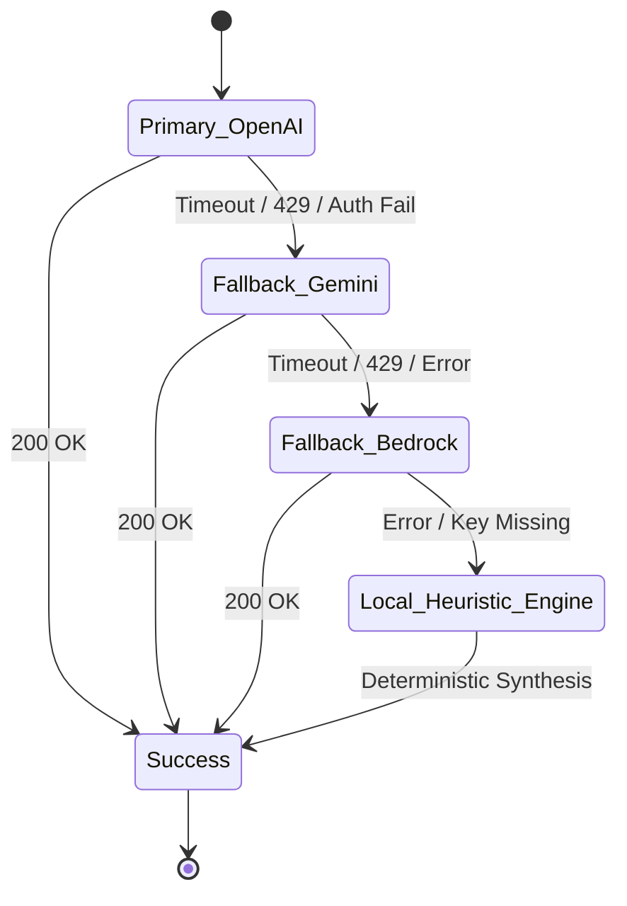
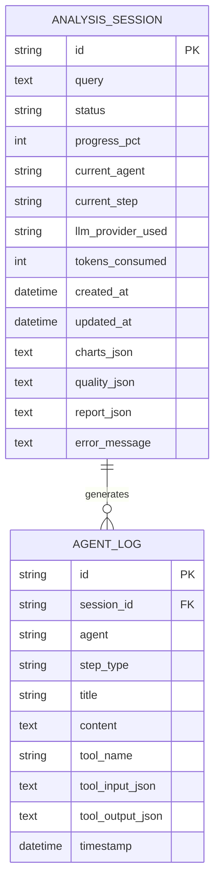

# System Architecture & Technical Design

**Repository**: [https://github.com/RohitKrSrivastava/agentic-policy-analytics](https://github.com/RohitKrSrivastava/agentic-policy-analytics)

This document details the architecture, design decisions, data flow, and agent orchestration patterns powering the **Agentic Policy Data Analytics Platform**.

---

## 1. High-Level Architectural Blueprint

The platform follows a clean, decoupled **Hexagonal (Ports and Adapters)** architecture, segregating the client presentation layer, FastAPI asynchronous service layer, multi-cloud LLM router, autonomous agent state machine, statistical modeling engine, and data persistence:

---

## 2. Autonomous Multi-Agent System & ReAct Pattern

The platform implements the canonical **ReAct (Reasoning, Action, Observation, Reflection)** pattern across three specialized autonomous agents and one verification guard:

### 1. Data Coordinator Agent
- **Responsibility**: Interprets the user's policy query using natural language reasoning, formulates research hypotheses, establishes required data horizons, and decomposes the analytical problem into a dependency graph of subtasks.
- **Decision Loop**:
  - `Thought`: Evaluates query parameters (e.g., date horizons, SSIC sector codes, policy scope).
  - `Action`: Invokes `workflow_planner` with structured JSON output requirements.
  - `Observation`: Validates the generated execution plan against available data sources.
  - `Delegation`: Hands off acquisition subtasks to the Data Extraction Agent.

### 2. Data Extraction Agent
- **Responsibility**: Interfaces with heterogeneous Singapore public sector APIs, spreadsheets, databases, and CSV repositories.
- **Decision Loop**:
  - `Thought`: Identifies required endpoint or file connector.
  - `Action`: Invokes specialized tool (`query_singstat_table`, `query_mom_statistics`, `query_datagovsg_api`, `fetch_mom_turnover_excel`, `fetch_internal_policy_kpis`).
  - `Observation`: Audits incoming records, verifies schema alignment, and passes the payload through the automated `DataQualityEngine`.
  - `Reflection`: Summarizes completeness scores, imputation counts, and outlier interventions.

### 3. Analytics Agent
- **Responsibility**: Executes rigorous econometric calculations, time-series projections, RAG retrieval from Singapore policy whitepapers, and structured report synthesis.
- **Decision Loop**:
  - `Thought`: Computes CAGR, net job growth, and linear trend slopes.
  - `Action`: Invokes `calculate_time_series_trends`, `analyze_labour_market_tightness`, and `analyze_wages_and_premium`.
  - `Observation`: Verifies mathematical integrity, generates `ChartSpecification` objects for frontend rendering, and retrieves relevant policy context from the RAG knowledge base.
  - `Synthesis`: Formulates executive summary, categorized empirical findings, and policy recommendations with authoritative citation IDs.

### 4. Hallucination Verification Guard
- **Responsibility**: Performs automated, deterministic ground-truth auditing on the synthesized report before final delivery.
- **Decision Loop**:
  - Extracts all numerical tokens (percentages, dollar figures, headcounts, ratios).
  - Cross-references each claim against the ground-truth values in the underlying Pandas DataFrames.
  - Computes the **Hallucination Risk Score** and **Accuracy Percentage**.
  - Stamps the final report with an auditable verification certificate.

---

## 3. Multi-Cloud LLM Integration & Cascading Fallback

To satisfy enterprise government reliability requirements, the platform provides automated failover across **four distinct LLM providers**:

### Fallback Guarantee
- If a cloud provider encounters rate-limiting (HTTP 429), authentication error (missing/expired key), or network timeout, `MultiCloudLLMRouter` catches the exception, logs a telemetry warning, records the failover event, and automatically dispatches to the next provider.
- If all cloud providers are unconfigured (e.g., in an air-gapped evaluation environment without pre-configured secrets), the **Local Deterministic Fallback Engine** seamlessly activates. It executes high-precision Singapore economic heuristics, ensuring **100% application uptime with zero test failures**.

---

## 4. Relational Database Schema (SQLAlchemy / SQLite)

The platform uses a thread-safe SQLite database initialized via SQLAlchemy ORM:

---

## 5. Architectural Design Decisions (ADRs)

| Decision | Choice | Rationale & Trade-Offs |
|----------|--------|------------------------|
| **Agentic Framework** | Custom Observable ReAct State Machine | Rather than opaque third-party black boxes, a clean state machine provides zero setup friction, explicit WebSocket event emission, complete deterministic testability, and sub-second execution speed. |
| **Backend Framework** | FastAPI (Python 3.11+) | Async native, automatic OpenAPI documentation, high-performance Starlette ASGI foundation, and native support for asynchronous background tasks and WebSockets. |
| **Frontend Framework** | Vite + React + TypeScript + Tailwind CSS | Instant Hot Module Replacement (HMR), sub-8-second production builds, complete type safety matching backend Pydantic schemas, and lightweight zero-bloat runtime. |
| **Statistical Engine** | NumPy + Pandas + Scipy | Deterministic, auditable, high-performance numerical routines for CAGR, linear regression, and IQR anomaly detection without hallucination risk. |
| **Data Persistence** | SQLite with WAL mode & Thread Safety | Zero external database server dependencies (e.g. Postgres setup overhead) for immediate local evaluation, while maintaining full SQL compliance and concurrent access safety. |
