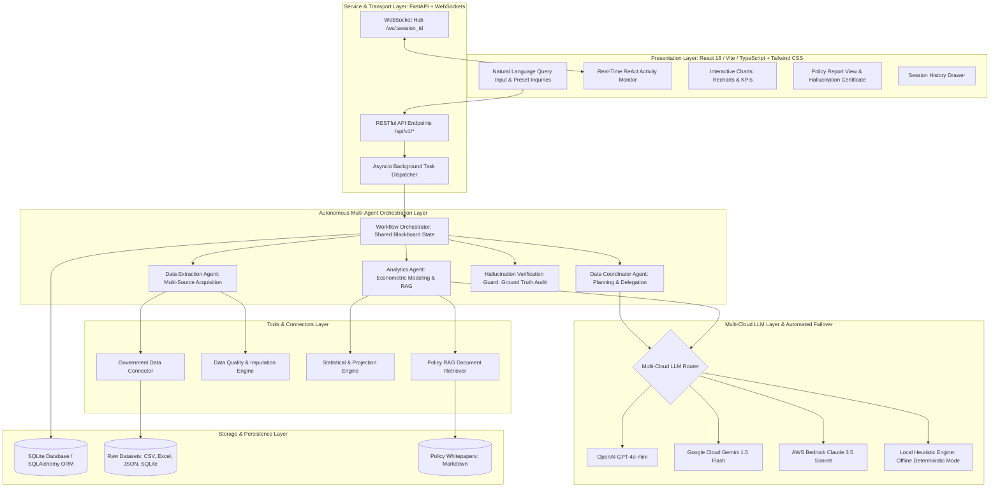
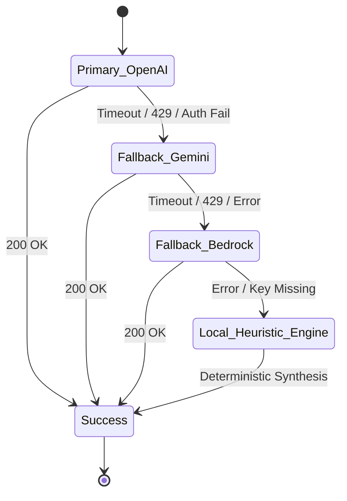
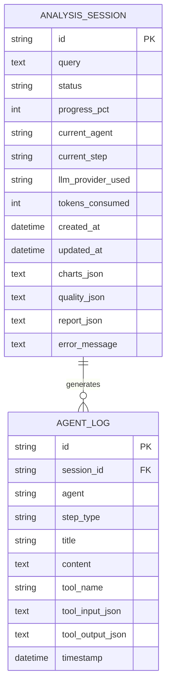

# System Architecture & Technical Design

**Repository**: [https://github.com/RohitKrSrivastava/agentic-policy-analytics](https://github.com/RohitKrSrivastava/agentic-policy-analytics)

This document details the architecture, design decisions, data flow, and agent orchestration patterns powering the **Agentic Policy Data Analytics Platform**.

---

## 1. High-Level Architectural Blueprint

The platform follows a clean, decoupled **Hexagonal (Ports and Adapters)** architecture, segregating the client presentation layer, FastAPI asynchronous service layer, multi-cloud LLM router, autonomous agent state machine, statistical modeling engine, and data persistence:



---

## 2. Autonomous Multi-Agent System & ReAct Pattern

### LangGraph-Aligned Asynchronous StateGraph Architecture (Architectural Decision)
The platform structures workflow execution as a compiled asynchronous **StateGraph** (`backend/app/agents/state_graph.py`), adhering directly to LangGraph conventions while maintaining lightweight native implementation. The execution graph coordinates nodes, conditional branch routers, and cyclic replanning edges:

```mermaid
flowchart LR
    START((__start__)) --> PLAN[Node: Plan]
    PLAN --> ROUTE_PLAN{route_plan}
    ROUTE_PLAN -->|Valid Query| EXTRACT[Node: Extract]
    ROUTE_PLAN -->|Out of Scope / Clarify| PUBLISH[Node: Publish]
    EXTRACT --> CHECK{Node: Check Coverage}
    CHECK --> ROUTE_COV{route_coverage}
    ROUTE_COV -->|Complete Data| ANALYZE[Node: Analyze]
    ROUTE_COV -->|Missing Source| REPLAN[Node: Replan]
    REPLAN -->|Loop (max 2)| CHECK
    REPLAN -->|Exhausted| ANALYZE
    ANALYZE --> PUBLISH
    PUBLISH --> END((__end__))
```

This design provides four key advantages for government policy applications:
1. **Zero Black-Box Overhead**: Full visibility and deterministic debugging over every graph state transition without external dependency bloat.
2. **Native WebSocket Streaming**: Fine-grained, real-time broadcasts of ReAct steps (`thought`, `action`, `observation`, `reflection`) streamed directly to the frontend monitor during each node execution.
3. **Thread-Safe Audit Trail**: Immutable persistence of all agent thoughts, tool inputs, tool outputs, and LLM replanning reflections directly into SQLite for Whole-of-Government (WOG) accountability.
4. **Typed Schema Enforcement**: Every authorized tool binds to a strict Pydantic model (`tool.args_schema.model_validate`), ensuring malformed arguments are trapped at the boundary.

---

### Agent Responsibilities & ReAct Execution Cycles

### 1. Data Coordinator Agent
- **Responsibility**: Interprets the user's policy query using natural language reasoning, formulates research hypotheses, establishes required data horizons, and decomposes the analytical problem into a dependency graph of subtasks.
- **Decision Loop**:
  - `Thought`: Evaluates query parameters (e.g., date horizons, SSIC sector codes, policy scope).
  - `Action`: Invokes `workflow_planner` with structured JSON output requirements.
  - `Observation`: Validates the generated execution plan against available data sources.
  - `Delegation`: Hands off acquisition subtasks to the Data Extraction Agent.

### 2. Data Extraction Agent (ReAct Decision Loop)
- **Responsibility**: Deliberates on empirical data requirements, dynamically invokes tools from the authorized `TOOL_REGISTRY`, observes results in a persistent scratchpad, and decides when data collection is complete.
- **ReAct Execution Cycle**:
  - `Deliberation & Prompting`: Live LLM receives query objectives, registry tools with JSON schemas, and prior scratchpad observations.
  - `Tool Registry Validation`: Dispatches to typed tool functions (`query_singstat_table`, `query_mom_statistics`, `query_datagovsg_api`, `fetch_mom_turnover_excel`, `fetch_internal_policy_kpis`).
  - `Typed Argument Validation`: Executes `tool.args_schema.model_validate(args)`. On validation failure, logs an `Observation` with schema requirements and prompts the agent to correct parameters.
  - `Unknown Tool Reflection`: If the LLM proposes an unregistered tool, an `Observation` lists authorized tools to allow the model to self-correct (eliminating fragile regex remapping).
  - `Duplicate Call Guard`: Enforces step limits (max 8 steps) and blocks identical consecutive invocations.
  - `Deterministic Plan Fallback`: Automatically activates if `local_fallback` is active or if LLM JSON parsing fails consecutively.

### 3. Orchestrator Generalized Replanning Node & Transparent Substitution
- **Responsibility**: Inspects acquired datasets for coverage gaps across **all critical sources** (SingStat employment, MOM tightness, Data.gov.sg wages).
- **LLM-Driven Replanning (Max 2 Iterations)**:
  - If a source is empty, the Orchestrator triggers `CoordinatorAgent.decide_replan_action`, prompting the LLM to autonomously evaluate the coverage gap and choose a remediation strategy (`switch_sector`, `widen_window`, `substitute_source`).
  - Merges replanned datasets into state and records substitutions in `state["substitutions"]`.
  - **Transparent Substitution Disclosure**:
    - **Executive Summary**: Explicitly prefixes summaries with `[Data Substitution Notice: Sector '{orig}' had missing source data and was substituted with '{repl}' baseline data]`.
    - **Dedicated Finding**: Automatically injects a cautionary finding at index 0: `"Data Substitution Notice: '{orig}' Replaced with '{repl}' Baseline"`.
    - **Citation Provenance**: Appends `(Substituted proxy for missing '{orig}')` directly to dataset titles and retrieval access methods.

### 4. Analytics Agent, Dynamic Comparative Wording & Self-Correction
- **Responsibility**: Executes econometric modeling (CAGR, Beveridge curve vacancy-to-retrenchment correlation $r$, $p$-value, 95% forecast prediction intervals), multi-sector comparative evaluations, policy RAG retrieval, and policy brief synthesis.
- **Dynamic Comparative Wording**:
  - In multi-sector evaluations (e.g. Tech vs Finance), the agent dynamically evaluates the sign of CAGR and net employment changes for each sector (`expanded` vs `contracted`).
  - Accurately conveys divergent trends (e.g. Tech expanded whereas Construction contracted) rather than assuming uniform positive expansion.
- **Self-Correction & Honest Pruning**:
  - Submits synthesized report to the `HallucinationVerificationGuard`.
  - If discrepancies or ungrounded claims are detected, executes up to 2 repair iterations with targeted repair prompts.
  - **Honest Pruning Notice**: If all synthesized claims fail factual verification and are pruned, the system generates an explicit `"Factual Audit Notice: No Claims Verified"` cautionary finding with 0 verified claims and forces `verification_status = "unverified"`, eliminating synthetic ungrounded claims.

### 5. Hallucination Verification Guard
- **Responsibility**: Performs automated, deterministic ground-truth auditing on the synthesized report before final delivery.
- **Decision Loop**:
  - Extracts all numerical tokens (percentages, dollar figures, headcounts, ratios).
  - Cross-references each claim against the ground-truth values in the underlying Pandas DataFrames and RAG policy chunks (`RAG_POLICY_FACT`).
  - Computes the **Hallucination Risk Score** and **Accuracy Percentage**.
  - Binds the verification status badge (`VERIFIED` in green, `PARTIALLY VERIFIED` with discrepancy count in amber, `UNVERIFIED`/`UNVERIFIABLE` in red).

---

## 3. Multi-Cloud LLM Integration & Cascading Fallback

To satisfy research prototype reliability requirements, the platform provides automated failover across **four distinct LLM providers**:



### Fallback Guarantee
- If a cloud provider encounters rate-limiting (HTTP 429), authentication error (missing/expired key), or network timeout, `MultiCloudLLMRouter` catches the exception, logs a telemetry warning, records the failover event, and automatically dispatches to the next provider.
- If all cloud providers are unconfigured (e.g., in an offline evaluation environment without pre-configured secrets), the **Local Deterministic Fallback Engine** seamlessly activates. It executes high-precision Singapore economic heuristics, ensuring **100% application uptime with zero test failures**.

---

## 4. Relational Database Schema (SQLAlchemy / SQLite)

The platform uses a thread-safe SQLite database initialized via SQLAlchemy ORM:



---

## 5. Architectural Design Decisions (ADRs)

| Decision | Choice | Rationale & Trade-Offs |
|----------|--------|------------------------|
| **Agentic Framework** | LangGraph-Aligned StateGraph with Observable ReAct | Adheres strictly to the LangGraph `StateGraph` pattern (`plan` -> `extract` -> `check_coverage` -> `replan` -> `analyze` -> `publish`) implemented in clean Python. Provides zero setup friction, deterministic testing, fine-grained WebSocket telemetry, and explicit cyclic replanning. |
| **Backend Framework** | FastAPI (Python 3.11+) | Async native, automatic OpenAPI documentation, high-performance Starlette ASGI foundation, and native support for asynchronous background tasks and WebSockets. |
| **Frontend Framework** | Vite + React + TypeScript + Tailwind CSS | Instant Hot Module Replacement (HMR), sub-8-second production builds, complete type safety matching backend Pydantic schemas, and lightweight zero-bloat runtime. |
| **Statistical Engine** | NumPy + Pandas + Scipy | Deterministic, auditable, high-performance numerical routines for CAGR, linear regression, and IQR anomaly detection without hallucination risk. |
| **Data Persistence** | SQLite with WAL mode & Thread Safety | Zero external database server dependencies (e.g. Postgres setup overhead) for immediate local evaluation, while maintaining full SQL compliance and concurrent access safety. |
