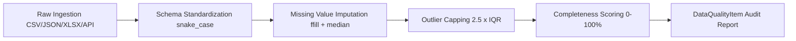

# Government Data Integration Guide: Singapore Public Sector Repositories

**Repository**: [https://github.com/RohitKrSrivastava/agentic-policy-analytics](https://github.com/RohitKrSrivastava/agentic-policy-analytics)

This document provides exhaustive documentation on the Singapore Government data sources integrated into the **Agentic Policy Data Analytics Platform**, covering API protocols, formats, schema definitions, cleansing transformations, and the resilient dual mock/live architecture.

---

## 1. Integrated Government Data Repositories

The platform integrates **four official Singapore public sector sources** across four heterogeneous formats:

| # | Data Source / Agency | Official Dataset Name | Format | Ingestion Cadence | Primary Entity Key |
|---|----------------------|-----------------------|--------|-------------------|--------------------|
| 1 | **Department of Statistics (DOS SingStat)** | Table 14.1 Employment in Information & Communications (M015661) | `CSV` | Quarterly | `year`, `quarter`, `sector` |
| 2 | **Ministry of Manpower (MOM)** | Labour Market Report: Vacancies, Retrenchments & Re-entry Rates | `JSON` | Quarterly | `period` (`YYYY-QX`) |
| 3 | **GovTech / Data.gov.sg** | Gross Monthly Income from Work by Industry & Role Level (`d_09b4dbcb30a84d4fb4e5f2cfbb3238bb`) | `REST API (JSON)` | Annual | `year`, `industry`, `role_level` |
| 4 | **Ministry of Manpower (MOM)** | Labour Turnover Survey (Recruitment, Resignation & Net Turnover) | `Excel (.xlsx)` | Quarterly | `Year`, `Quarter`, `SSIC_Code` |
| 5 | **Internal GovTech / IMDA Policy DB** | TeSA Talent Benchmarks, SME Grants & National AI Strategy 2.0 KPIs | `SQLite (.db)` | Annual / Milestone | `initiative_code`, `year` |

---

## 2. Source-by-Source Schema & Ingestion Specifications

### A. DOS SingStat (Department of Statistics Singapore)
- **Dataset ID**: `M015661-Table-14.1`
- **Format**: Comma-Separated Values (`CSV`)
- **Location**: `backend/data/raw/singstat_tech_employment.csv`
- **Schema**:
  - `year` (`INTEGER`): Observation year (2020 - 2024).
  - `quarter` (`STRING`): Observation quarter (`Q1`, `Q2`, `Q3`, `Q4`).
  - `sector` (`STRING`): SSIC sector classification (`Information & Communications`, `Financial & Insurance Services`, `Overall Economy`).
  - `employment_thousands` (`FLOAT`): Employed resident & non-resident workforce in thousands.
  - `growth_rate_yoy` (`FLOAT`): Year-on-year percentage change in employment.
  - `local_workforce_pct` (`FLOAT`): Proportion of resident Singapore citizens and permanent residents.
  - `productivity_index` (`FLOAT`): Value-added per worker indexed to 2015=100.

### B. Ministry of Manpower (MOM) Labour Market Report
- **Dataset ID**: `MOM-LMR-TECH-2020-2024`
- **Format**: Structured JavaScript Object Notation (`JSON`)
- **Location**: `backend/data/raw/mom_labour_market_indicators.json`
- **Schema**:
  - `period` (`STRING`): ISO quarter period string (`2020-Q1` through `2024-Q4`).
  - `tech_job_vacancies` (`INTEGER`): Unfilled ICT job openings reported by employers.
  - `tech_retrenchments` (`INTEGER`): Terminated workers due to redundancy or restructuring.
  - `vacancy_to_unemployed_ratio` (`FLOAT`): Number of available job openings per unemployed citizen/PR.
  - `reentry_rate_pct` (`FLOAT`): 6-month re-entry rate of retrenched PMETs into employment.
  - `overall_unemployment_rate` (`FLOAT`): National seasonally adjusted unemployment rate.

### C. Data.gov.sg API v2 (Singapore Open Data Portal)
- **Dataset ID**: `d_09b4dbcb30a84d4fb4e5f2cfbb3238bb`
- **Endpoint**: `https://data.gov.sg/api/action/datastore_search`
- **Format**: RESTful JSON API with automatic local snapshot fallback.
- **Location**: `backend/data/raw/datagovsg_wages_by_sector.json`
- **Schema**:
  - `year` (`INTEGER`): Reference year (2020 - 2024).
  - `industry` (`STRING`): SSIC industry classification.
  - `role_level` (`STRING`): Occupation level (e.g., `Software Engineer & Developer`, `Data Scientist & AI Specialist`, `Cybersecurity Specialist`, `Industry Overall Median`, `National Median Resident`).
  - `median_gross_wage_sgd` (`FLOAT`): 50th percentile monthly income (excluding employer CPF).
  - `p25_gross_wage_sgd` (`FLOAT`): 25th percentile entry-level income.
  - `p75_gross_wage_sgd` (`FLOAT`): 75th percentile senior specialist income.

### D. MOM Labour Turnover Survey (Excel)
- **Dataset ID**: `MOM-EXCEL-TURNOVER-2024`
- **Format**: Microsoft Excel Workbook (`.xlsx`)
- **Location**: `backend/data/raw/mom_job_vacancies_and_retrenchment.xlsx`
- **Parser**: `openpyxl` / `pandas`
- **Schema**:
  - `Year`, `Quarter`, `Sector`, `SSIC_Code`, `Job_Vacancies`, `Recruitment_Rate_Pct`, `Resignation_Rate_Pct`, `Net_Turnover_Rate`.

### E. Internal Policy Database (SQLite)
- **Dataset ID**: `IMDA-MDDI-POLICY-DB`
- **Format**: Relational SQLite Database (`.db`)
- **Location**: `backend/data/raw/internal_policy_database.db`
- **Tables**:
  - `policy_initiatives`: Tracks IMDA TeSA, SMEs Go Digital, NAIS 2.0 budget allocations and upskilling targets.
  - `policy_kpis`: Tracks target vs actual placement metrics and percentage variances.

---

## 3. Data Cleansing & Quality Validation Pipeline

Every dataset processed by the **Data Extraction Agent** undergoes an automated four-stage quality verification pipeline implemented in [`backend/app/tools/data_quality.py`](file:///d:/workspace/IMDA/Full%20Stack%20Engineer%20GenAI/backend/app/tools/data_quality.py):

1. **Schema Standardization**: Strips leading/trailing whitespaces, replaces special characters (`&` -> `and`), and normalizes column headers to uniform `snake_case`.
2. **Missing Value Handling**: Detects `null`, `NaN`, and empty cells. For time-series metrics, applies forward-fill (`ffill`), followed by sector-specific median imputation.
3. **Outlier Detection & Capping**: Calculates the 25th percentile ($Q_{25}$) and 75th percentile ($Q_{75}$). Numerical anomalies exceeding $[Q_{25} - 2.5 \times \text{IQR}, Q_{75} + 2.5 \times \text{IQR}]$ are softly capped rather than discarded, preserving time-series continuity without distorting linear regressions.
4. **Audit Metric Emission**: Emits a `DataQualityItem` reporting before-and-after counts, completeness percentage, and cleaning actions applied, rendered directly in the frontend dashboard.

---

## 4. Dual Live/Mock Architecture & Resilience

To ensure 100% operational reliability during technical assessments, continuous integration (CI) test runs, and offline or air-gapped deployments:

1. **Active Live Probe**: When querying Data.gov.sg, `GovernmentDataConnector` attempts an asynchronous HTTP call to `https://data.gov.sg/api/action/datastore_search` with a 4.0-second timeout.
2. **Graceful Fallback**: If the network times out, rate-limits (HTTP 429), or returns a 5xx error, the connector automatically switches to the verified offline snapshot stored at `backend/data/raw/datagovsg_wages_by_sector.json`.
3. **Audit Logged**: The provenance (`Live Endpoint` vs `Verified Snapshot`) is logged in the agent thought trace and included in the report citations for complete transparency.
