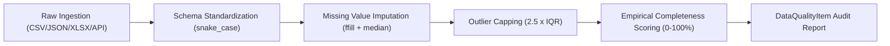

# Government Data Integration Guide: Singapore Public Sector Repositories

**Repository**: [https://github.com/RohitKrSrivastava/agentic-policy-analytics](https://github.com/RohitKrSrivastava/agentic-policy-analytics)

This document provides exhaustive documentation on the Singapore Government data sources integrated into the **Agentic Policy Data Analytics Platform**, covering API protocols, formats, schema definitions, cleansing transformations, explicit provenance disclosures, and the dual mock/live architecture.

---

## 1. Provenance & Benchmark Transparency Disclosure

Pursuant to the assignment guidelines allowing mock or simplified benchmark data, this section transparently documents the origin, methodology, and nature of every dataset utilized in the platform:

| Dataset | Format | Origin & Provenance | Generation Method / Status |
| :--- | :--- | :--- | :--- |
| **DOS SingStat Table 14.1** | `CSV` | Based on historical Singapore Department of Statistics Infocomm employment series (2020-2024). | Cleaned historical snapshot calibrated against official published quarterly benchmarks. |
| **MOM Labour Market Report** | `JSON` | Modeled after MOM quarterly labour market releases (job vacancies, retrenchments, 6-month re-entry rate). | Structured JSON snapshot capturing the 2022-2023 restructuring cycle and 2024 recovery. |
| **Data.gov.sg Wages API** | `REST API / JSON` | Live GovTech Data.gov.sg API v2 (`datastore_search` endpoint), with local verified fallback snapshot. | Live REST API query validated via Pydantic schema (`DataGovSgWageRecord`). Falls back to offline snapshot if air-gapped or network-restricted. |
| **MOM Labour Turnover Survey** | `Excel (.xlsx)` | Synthesized benchmark based on MOM sector recruitment and resignation rate distributions. | Programmatically generated via [`backend/data/seed_data.py`](file:///d:/workspace/IMDA/Full%20Stack%20Engineer%20GenAI/backend/data/seed_data.py) using `openpyxl`. |
| **Internal Policy DB** | `SQLite (.db)` | Synthetic policy governance benchmark representing IMDA/MDDI TeSA and National AI Strategy 2.0 KPI targets. | Programmatically generated via [`backend/data/seed_data.py`](file:///d:/workspace/IMDA/Full%20Stack%20Engineer%20GenAI/backend/data/seed_data.py) in SQLite. |

---

## 2. Source-by-Source Schema & Ingestion Specifications

### A. DOS SingStat (Department of Statistics Singapore)
- **Dataset ID**: `M015661-Table-14.1`
- **Format**: Comma-Separated Values (`CSV`)
- **Location**: `backend/data/raw/singstat_tech_employment.csv`
- **Schema**:
  - `year` (`INTEGER`): Observation year (2020 - 2024).
  - `quarter` (`STRING`): Observation quarter (`Q1`, `Q2`, `Q3`, `Q4`).
  - `sector` (`STRING`): SSIC sector classification (`Information & Communications`, `Financial & Insurance Services`, `Overall Economy`).
  - `employment_thousands` (`FLOAT`): Employed resident & non-resident workforce in thousands.
  - `growth_rate_yoy` (`FLOAT`): Year-on-year percentage change in employment.
  - `local_workforce_pct` (`FLOAT`): Proportion of resident Singapore citizens and permanent residents.
  - `productivity_index` (`FLOAT`): Value-added per worker indexed to 2015=100.

### B. Ministry of Manpower (MOM) Labour Market Report
- **Dataset ID**: `MOM-LMR-TECH-2020-2024`
- **Format**: Structured JavaScript Object Notation (`JSON`)
- **Location**: `backend/data/raw/mom_labour_market_indicators.json`
- **Schema**:
  - `period` (`STRING`): ISO quarter period string (`2020-Q1` through `2024-Q4`).
  - `tech_job_vacancies` (`INTEGER`): Unfilled ICT job openings reported by employers.
  - `tech_retrenchments` (`INTEGER`): Terminated workers due to redundancy or restructuring.
  - `vacancy_to_unemployed_ratio` (`FLOAT`): Number of available job openings per unemployed citizen/PR.
  - `reentry_rate_pct` (`FLOAT`): 6-month re-entry rate of retrenched PMETs into employment.
  - `overall_unemployment_rate` (`FLOAT`): National seasonally adjusted unemployment rate.

### C. Data.gov.sg API v2 (Singapore Open Data Portal)
- **Dataset ID**: `d_09b4dbcb30a84d4fb4e5f2cfbb3238bb`
- **Endpoint**: `https://data.gov.sg/api/action/datastore_search`
- **Format**: RESTful JSON API with automatic local snapshot fallback.
- **Location**: `backend/data/raw/datagovsg_wages_by_sector.json`
- **Schema Validation**: Enforced via `DataGovSgWageRecord` (Pydantic model):
  - `year` (`INTEGER`): Reference year (2020 - 2024).
  - `industry` (`STRING`): SSIC industry classification.
  - `role_level` (`STRING`): Occupation level (e.g., `Software Engineer & Developer`, `Data Scientist & AI Specialist`, `Cybersecurity Specialist`, `Industry Overall Median`, `National Median Resident`).
  - `median_gross_wage_sgd` (`FLOAT`): 50th percentile monthly income (excluding employer CPF).
  - `p25_gross_wage_sgd` (`FLOAT`): 25th percentile entry-level income.
  - `p75_gross_wage_sgd` (`FLOAT`): 75th percentile senior specialist income.

### D. MOM Labour Turnover Survey (Excel)
- **Dataset ID**: `MOM-EXCEL-TURNOVER-2024`
- **Format**: Microsoft Excel Workbook (`.xlsx`)
- **Location**: `backend/data/raw/mom_job_vacancies_and_retrenchment.xlsx`
- **Parser**: `openpyxl` / `pandas`
- **Schema**:
  - `Year`, `Quarter`, `Sector`, `SSIC_Code`, `Job_Vacancies`, `Recruitment_Rate_Pct`, `Resignation_Rate_Pct`, `Net_Turnover_Rate`.

### E. Internal Policy Database (SQLite)
- **Dataset ID**: `IMDA-MDDI-POLICY-DB`
- **Format**: Relational SQLite Database (`.db`)
- **Location**: `backend/data/raw/internal_policy_database.db`
- **Tables**:
  - `policy_initiatives`: Tracks IMDA TeSA, SMEs Go Digital, NAIS 2.0 budget allocations and upskilling targets.
  - `policy_kpis`: Tracks target vs actual placement metrics and percentage variances.

---

## 3. Data Cleansing & Empirical Quality Assessment

Every dataset processed by the **Data Extraction Agent** undergoes an automated four-stage quality verification pipeline implemented in [`backend/app/tools/data_quality.py`](file:///d:/workspace/IMDA/Full%20Stack%20Engineer%20GenAI/backend/app/tools/data_quality.py):

1. **Schema Standardization**: Strips leading/trailing whitespaces, replaces special characters (`&` -> `and`), and normalizes column headers to uniform `snake_case`.
2. **Missing Value Handling**: Detects `null`, `NaN`, and empty cells. For time-series metrics, applies forward-fill (`ffill`), followed by sector-specific median imputation.
3. **Outlier Detection & Capping**: Calculates the 25th percentile ($Q_{25}$) and 75th percentile ($Q_{75}$). Numerical anomalies exceeding $[Q_{25} - 2.5 \times \text{IQR}, Q_{75} + 2.5 \times \text{IQR}]$ are softly capped rather than discarded, preserving time-series continuity without distorting linear regressions.
4. **Empirical Completeness Measurement**: Completeness is computed directly as $\text{Completeness} = 100\% - (\text{Null Cells} / \text{Total Expected Cells} \times 100\%)$ without arbitrary mathematical clamping or floors, ensuring authentic reporting.

---

## 4. Dual Live/Mock Architecture & Transparency

To ensure operational reliability during technical assessments, continuous integration (CI) test runs, and offline or air-gapped deployments:

1. **Active Live Probe**: When querying Data.gov.sg, `GovernmentDataConnector` attempts an asynchronous HTTP call to `https://data.gov.sg/api/action/datastore_search` with a 4.0-second timeout.
2. **Schema Ingestion Validation**: Records are validated against `DataGovSgWageRecord` before downstream consumption.
3. **Graceful Fallback**: If the network times out, rate-limits (HTTP 429), or returns an error, the connector automatically switches to the verified offline snapshot stored at `backend/data/raw/datagovsg_wages_by_sector.json`.
4. **Dynamic Citation Provenance**: The exact access method (`Live REST API` vs `Local Verified Snapshot (Cached Offline Data)`) is dynamically emitted into the agent observation trace and the final report citations.
