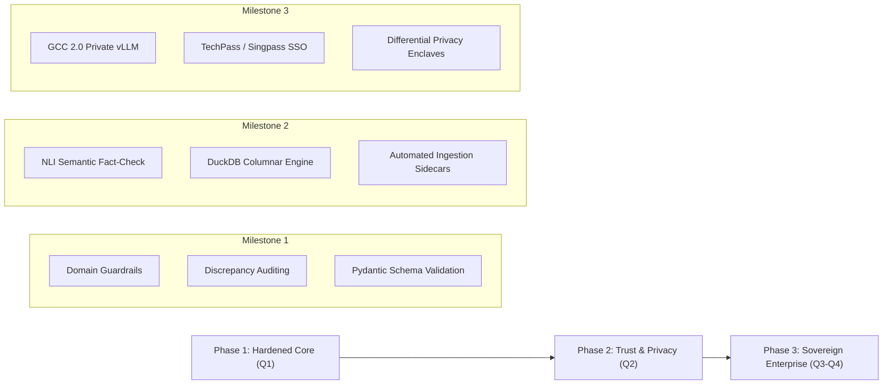

# Architectural Evolution & Engineering Assessment: Agentic Policy Analytics for Singapore Public Sector

**Repository**: [https://github.com/RohitKrSrivastava/agentic-policy-analytics](https://github.com/RohitKrSrivastava/agentic-policy-analytics)  
**Author**: [Rohit Kumar Srivastava](https://www.linkedin.com/in/rohit-kumar-srivastava-59921352/)  
**Target Context**: Singapore Public Sector, Whole-of-Government (WOG), GovTech SG, IMDA  
**Document Type**: Architectural Assessment & Strategic Evolution Brief (Section 2)  

---

## 1. Executive Summary & Implemented Capabilities

The **Agentic Policy Data Analytics Platform** implements a full-stack, multi-agent system designed to assist policy researchers, economists, and government analysts in synthesizing evidence-backed insights across heterogeneous Singapore manpower repositories.

### Currently Implemented Architecture
1. **Parameterized Multi-Agent Collaboration**: 
   - **Data Coordinator Agent**: Interprets query intent, extracts analytical parameters (`sector`, `start_year`, `end_year`, target metrics), and applies domain guardrails to detect and handle out-of-scope queries (e.g. non-Singapore jurisdictions or unrelated topics) rather than returning unrelated data.
   - **Data Extraction Agent**: Executes parameterized subtasks across 4 formats: DOS SingStat (`CSV`), MOM Labour Market Indicators (`JSON`), Data.gov.sg Wages (`REST API` with Pydantic schema validation and local snapshot fallback), and MOM Labour Turnover (`Excel .xlsx`), complemented by an internal policy SQLite database.
   - **Analytics Agent & Econometric Engine**: Computes time-series CAGR, labour market tightness ratios, and wage premiums, dynamically generating interactive Recharts visualisations.
2. **Empirical Data Quality Engine**: Sanitizes headers (`snake_case`), handles missing data via time-series forward fill and median imputation, caps statistical outliers via $2.5 \times \text{IQR}$ bounds, and reports unconstrained empirical completeness percentages without artificial floors.
3. **Source-Grounded Factuality & Discrepancy Auditing**: Extracts quantitative claims, filters structural temporal tokens, and evaluates claims against an exhaustive ground-truth index derived from extracted dataset records and computed models. Discrepancies and ungrounded fabrications are explicitly flagged with context and deviations.
4. **Multi-Cloud LLM Failover**: Resilient router supporting OpenAI (GPT-4o-mini), Google Cloud Gemini (1.5 Flash), AWS Bedrock (Claude 3.5 Sonnet via `boto3`), and an offline deterministic heuristic fallback engine.

---

## 2. Engineering Limitations & Pragmatic Trade-Offs

Operating transparently requires acknowledging architectural shortcuts and limitations present in early iterations:

| Area | Current Implementation Baseline | Limitation / Trade-Off | Remediation & Evolution Path |
| :--- | :--- | :--- | :--- |
| **Factuality Auditing** | Value-based numeric verification with 1.5% tolerance against source DataFrames. | Validates quantitative claims, but does not verify natural language semantic nuance or causal rhetoric. | Integrate Natural Language Inference (NLI) cross-encoders to verify qualitative statements against RAG policy chunks. |
| **Local Offline Fallback** | Deterministic heuristic engine dynamically structured by query parameters. | High reliability for automated testing without API keys, but lacks generative fluency of true LLMs. | Deploy local quantized small language models (e.g., Llama-3-8B or SEA-LION) via Ollama/vLLM for offline air-gapped environments. |
| **Data Provenance** | Historical SingStat and MOM snapshots with programmatic Excel and SQLite seeds. | Datasets serve as realistic benchmarks (as permitted by brief), but lack automated real-time ingestion pipelines. | Develop automated cron ingestion sidecars connecting directly to Data.gov.sg v2 and SingStat Open Data APIs with schema migration handlers. |
| **Data Quality Scoring** | Directly measured cell completeness and IQR anomaly tracking. | Assumes uniform column weighting; does not capture multi-column joint integrity constraints. | Implement Great Expectations / Pydantic V2 composite validator suites enforcing relational referential integrity. |

---

## 3. Strategic Roadmap for Secure Government Environments

To elevate this platform from an evaluated prototype into an enterprise capability aligned with Singapore's **Government Commercial Cloud (GCC 2.0)** and **Instruction Manual 8 (IM8)** guidelines, four architectural evolutions are prioritized:

### A. GCC 2.0 & IM8 Sovereign Enclaves
- **On-Premise / Sovereign Inference**: Deploy quantized regional models (e.g. Singapore's SEA-LION or open-weights foundation models) via vLLM on private GCC clusters, ensuring sensitive policy inquiries never egress outside government network boundaries.
- **Whole-of-Government (WOG) Identity**: Integrate GovTech TechPass and Singpass with Role-Based Access Control (RBAC), restricting policy brief access according to security classification levels (Restricted / Confidential).

### B. Privacy-Preserving Analytics for Sensitive Microdata
- In scenarios involving granular CPF wage contributions or employer-level retrenchment filings, integrate Local Differential Privacy (LDP) algorithms (calibrated Laplace noise) allowing researchers to query sector distributions without de-anonymizing individual citizens or firms.

### C. Big Data Scaling via Columnar Storage
- Migrate the analytical backplane from standard in-memory Pandas to **DuckDB / Apache Arrow**, enabling sub-second analytical queries across gigabyte-scale census and labor force tables directly within lightweight container memory envelopes.

---

## 4. Phased Implementation Roadmap

By balancing genuine agentic autonomy, transparent source-grounded verification, and honest engineering rigor, the platform provides a defensible, auditable foundation for modern public policy decision-making.
