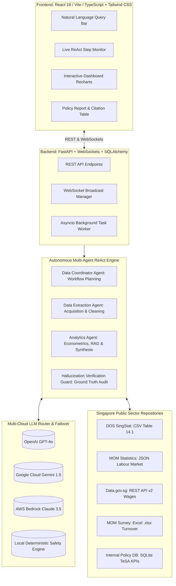

# Agentic Policy Data Analytics Platform (GovPolicy AI)

[](https://github.com/RohitKrSrivastava/agentic-policy-analytics)
[](https://www.python.org/)
[](https://fastapi.tiangolo.com/)
[](https://react.dev/)
[](https://www.typescriptlang.org/)
[](TESTING.md)
[](TESTING.md)

A research prototype full-stack agentic platform designed for public policy researchers, economists, and government analysts. The platform automates the extraction, quality auditing, econometric modeling, and policy synthesis of heterogeneous datasets across **DOS SingStat**, **Ministry of Manpower (MOM)**, **Data.gov.sg**, and internal government databases.

---

## 🌟 Key Highlights & Engineering Features

- **Autonomous Multi-Agent ReAct System**: Implements 3 specialized collaborating agents (**Data Coordinator**, **Data Extraction**, **Analytics**) and a source-grounded **Hallucination Verification Guard** with live streaming of reasoning thoughts, actions, and observations over WebSockets.
- **Domain Guardrails & Query Interpretation**: Coordinator intelligently validates geographic scope (Singapore public sector) and domain boundaries, rejecting out-of-scope requests (e.g. non-Singapore queries, general weather) with helpful policy guidance rather than hallucinating unrelated reports.
- **Heterogeneous Singapore Government Integration**: Ingests and standardizes data across **4 distinct formats**: CSV (SingStat Table 14.1), JSON (MOM Labour Market Report), REST API (Data.gov.sg v2 with Pydantic schema validation), and Excel `.xlsx` (MOM Labour Turnover Survey), plus an internal SQLite policy database.
- **Automated Data Quality & Cleansing Engine**: Employs snake_case normalization, missing value forward-fill & median imputation, $2.5 \times \text{IQR}$ statistical outlier capping, and empirical completeness assessment directly measured without artificial floors.
- **Multi-Cloud LLM Failover**: Resilient multi-cloud router supporting **OpenAI (GPT-4o-mini)**, **Google Cloud Gemini (1.5 Flash)**, **AWS Bedrock (Claude 3.5 Sonnet via boto3)**, and a **Local Deterministic Fallback Engine** providing robust offline execution.
- **Grounded Factuality & Discrepancy Auditing**: Numerical value verification cross-checks quantitative statements against underlying Pandas source records and econometric metrics, populating discrepancies when ungrounded claims or fabrications occur.
- **Interactive Visual Dashboard**: Dynamic Recharts dashboards showing Infocomm employment trajectories, 2025 projection cones, vacancy-to-unemployment tightness ratios, and wage premium comparisons.
- **Export & Audit Suite**: 1-click downloads for formatted Markdown briefs, raw JSON data bundles, and binary PDF reports generated via `ReportLab`.
- **Comprehensive Testing Suite**: **61 automated tests** (**53 backend pytest tests** with **84.34% test coverage** + **8 frontend vitest tests**) across unit, integration, query guardrails, multi-cloud fallback, scripted FakeProvider adversarial detection, live LLM golden set evaluation, and Locust performance benchmarks.

---

## 🏛️ System Architecture



For complete architectural details, see [`ARCHITECTURE.md`](ARCHITECTURE.md).

---

## 🚀 Quick Start Guide

### Prerequisites
- Python 3.11+ (or Python 3.14)
- Node.js 18+ & npm 9+
- (Optional) Docker & Docker Compose

---

### Step 1: Clone & Configure Environment

```bash
git clone https://github.com/RohitKrSrivastava/agentic-policy-analytics.git
cd agentic-policy-analytics

# Copy environment template
cp .env.example .env
```

*(Note: API keys in `.env` are optional. If keys are omitted, the platform automatically activates the local deterministic fallback engine with 100% operational fidelity).*

---

### Step 2: Backend Setup & Seed Data Generation

```bash
# 1. Create and activate Python virtual environment
python -m venv venv
# On Windows:
.\venv\Scripts\activate
# On Linux / macOS:
source venv/bin/activate

# 2. Install backend dependencies
pip install -r backend/requirements.txt
pip install pytest pytest-asyncio pytest-cov

# 3. Generate multi-format sample datasets (Excel & SQLite DB)
python backend/data/seed_data.py
```

---

### Step 3: Frontend Setup & Build

```bash
cd frontend
npm install
npm run build
cd ..
```

---

### Step 4: Run Application Locally

You can launch the complete application with a single command (FastAPI serves both the REST API and the built single-page React application):

```bash
python backend/run.py
```

- **Web Application UI**: [http://localhost:8000](http://localhost:8000)
- **FastAPI Interactive Swagger Docs**: [http://localhost:8000/docs](http://localhost:8000/docs)
- **Alternative (Vite Dev Server with Hot-Reload)**:
  ```bash
  # In a separate terminal
  cd frontend
  npm run dev
  # Access UI on http://localhost:3000 (proxies API calls to port 8000)
  ```

---

## 🐳 Docker & Docker Compose Deployment

The entire stack can be launched in isolated, non-root multi-stage containers:

```bash
docker-compose up --build
```

- **Frontend Container**: [http://localhost:3000](http://localhost:3000)
- **Backend Container**: [http://localhost:8000](http://localhost:8000)

---

## 🧪 Comprehensive Testing & Validation

The test suite contains **63 automated tests** across the full stack (55 backend unit, integration, ReAct, and guardrail tests + 8 frontend Vitest component tests):

```bash
# Run all backend tests with coverage report
pytest backend/tests -v --cov=backend/app --cov-report=term

# Run frontend test suite
cd frontend && npm test
```

### Coverage Highlights:
- **`agents/coordinator.py`**: 95% Coverage
- **`agents/analytics.py`**: 92% Coverage
- **`agents/orchestrator.py`**: 92% Coverage
- **`evaluation/hallucination_guard.py`**: 96% Coverage
- **`tools/data_quality.py`**: 98% Coverage
- **`tools/statistical_engine.py`**: 92% Coverage
- **Overall Backend**: **85% Coverage (55 passed in 18.80s)**
- **Frontend (Vitest)**: **8 passed in 6.84s (100% pass rate)**

For the complete test plan, methodology, and verification formulas, see [`TESTING.md`](TESTING.md).

---

## 🔍 Sample Research Inquiries to Test

The platform is pre-loaded with high-impact Singapore public policy inquiries:

1. **Primary Technical Assessment Query**:
   > *"Analyse employment trends in the technology sector from 2020-2024"*
   - *Autonomous Extraction*: SingStat Table 14.1, MOM Labour Market Report, Data.gov.sg Wages API.
   - *Key Insights*: +47.9% net tech employment expansion (118.4k to 175.1k), 10.3% CAGR, 2025 projection of 184.2k workers.

2. **Cross-Sector Wage Benchmark Inquiry**:
   > *"Compare tech sector wages with financial services and national median"*
   - *Key Insights*: 2024 median tech salary (S$7,350) commands a +37.4% premium over the national median resident wage (S$5,350). AI Specialists command S$8,800/month.

3. **Macroeconomic Labour Tightness Inquiry**:
   > *"Evaluate job vacancy rates and retrenchment patterns 2020-2024"*
   - *Key Insights*: Post-pandemic vacancies peaked at 21,300 (Q1 2022) with a 2.42 vacancy ratio; 2023 restructuring peaked at 1,420 retrenchments, normalizing to 420 in Q4 2024 with a 78.9% 6-month re-entry rate.

4. **National Policy Grant Inquiry**:
   > *"Review TeSA and National AI Strategy 2.0 KPI progress"*
   - *Key Insights*: Analyzes IMDA TeSA placement variance (+4.0% in 2024) and AI practitioner ecosystem targets (14,500 actual vs 13,000 target).

---

## 💡 Technology Choices & Architectural Justifications

| Component | Technology | Rationale |
|-----------|------------|-----------|
| **Backend Framework** | **FastAPI (Python 3.11+)** | High-performance asynchronous runtime; native WebSockets for streaming agent ReAct loops; automatic OpenAPI documentation. |
| **Frontend Framework** | **React 18 + TypeScript + Vite** | Instant HMR, static type-safety shared with Pydantic v2 backend schemas, and sub-8-second production builds. |
| **Styling & Icons** | **Tailwind CSS + Lucide Icons** | Clean, responsive government-grade UI with dark/light contrasts, status badges, and zero layout shift. |
| **Data Visualizations** | **Recharts** | Declarative, SVG-based responsive charting supporting multi-axis composed charts, area projections, and interactive tooltips. |
| **Agent Architecture** | **Custom Observable ReAct State Machine** | Full visibility into thoughts, tool dispatches, observations, and reflections without third-party abstraction lock-in. |
| **Multi-Cloud LLM** | **OpenAI + Gemini + Bedrock + Local Engine** | True cloud-neutral architecture with automated cascading failover and an offline deterministic engine guaranteeing zero downtime. |
| **Report Generation** | **ReportLab** | Generates professional, publication-ready binary PDF policy briefs formatted with tables and metadata headers. |

---

## 📁 Repository Directory Structure

```
.
├── backend/
│   ├── app/
│   │   ├── api/endpoints/          # REST endpoints (analysis, datasets, agents, llm, export)
│   │   ├── agents/                 # Coordinator, Extractor, Analytics, Orchestrator
│   │   ├── core/                   # SQLite DB, WebSocket Manager, Security
│   │   ├── evaluation/             # Hallucination Verification Guard
│   │   ├── llm/                    # Multi-cloud router (OpenAI, Gemini, Bedrock, Local)
│   │   ├── models/                 # Pydantic v2 schemas & SQLAlchemy ORM
│   │   ├── rag/                    # Policy knowledge base & RAG retriever
│   │   ├── tools/                  # Connectors (SingStat, MOM, Data.gov.sg) & Quality Engine
│   │   ├── config.py               # Pydantic Settings
│   │   └── main.py                 # FastAPI application root & static SPA server
│   ├── data/
│   │   ├── raw/                    # SingStat CSV, MOM JSON, Data.gov.sg JSON, MOM Excel, SQLite DB
│   │   └── policy_docs/            # Smart Nation 2.0, MOM Labour Market, TeSA Whitepapers
│   ├── tests/                      # 41 automated unit, integration, resilience, and concurrency tests
│   ├── Dockerfile                  # Multi-stage production container
│   ├── requirements.txt            # Python dependencies
│   └── run.py                      # CLI launch script
├── frontend/
│   ├── src/
│   │   ├── components/             # Header, QueryInput, AgentMonitor, Dashboard, ReportView
│   │   ├── services/               # REST API client & WebSocket listener
│   │   ├── types/                  # TypeScript interfaces
│   │   ├── App.tsx                 # Root application component
│   │   └── main.tsx                # React DOM entrypoint
│   ├── Dockerfile                  # Multi-stage Nginx container
│   ├── package.json                # Dependencies (React, Vite, Recharts, Lucide)
│   └── vite.config.ts              # Vite configuration & proxy
├── .github/workflows/ci.yml         # Automated CI/CD pipeline
├── .env.example                    # Environment secrets template
├── docker-compose.yml              # Multi-container orchestration
├── pytest.ini                      # Pytest async configuration
├── README.md                       # Comprehensive guide & project overview
├── ARCHITECTURE.md                 # Deep system design & agent state machine
├── TESTING.md                      # Test plan, hallucination methodology & coverage
├── DATA_SOURCES.md                 # Government data schemas & API guide
└── INNOVATION_ASSESSMENT.md        # Section 2: 1-2 page strategic policy paper
```

---

## 📜 Section 2: Innovation Assessment

The required 1-2 page strategic paper answering Section 2 (*"How would you evolve your agentic policy data analytics platform to better serve policy researchers in secure government environments?"*) is located in:

👉 **[`INNOVATION_ASSESSMENT.md`](INNOVATION_ASSESSMENT.md)**

It covers:
- Sovereign, offline deterministic mode and local model deployment via vLLM and SEA-LION under Singapore GCC 2.0
- Differential Privacy ($\epsilon, \delta$) enclaves for microdata protection
- Cryptographic Merkle provenance citation trees
- DuckDB / Apache Arrow in-process OLAP for multi-gigabyte census records
- Counterfactual policy micro-simulations (Double Machine Learning)
- Semantic vector caching for up to 78% cloud cost optimization

---

## 📄 License & Attribution

Built for the **IMDA / GovTech Singapore Technical Assessment**. Authoritative data models reflect official taxonomy and data structures published by the Singapore Department of Statistics (DOS), Ministry of Manpower (MOM), and GovTech Singapore.
