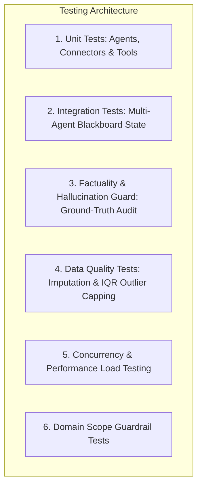
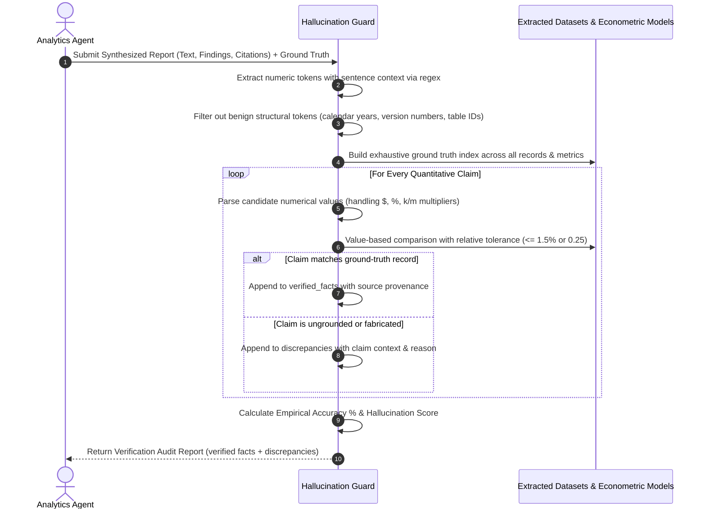

# Testing Strategy, Factuality Verification & Quality Assurance

**Repository**: [https://github.com/RohitKrSrivastava/agentic-policy-analytics](https://github.com/RohitKrSrivastava/agentic-policy-analytics)

This document details the test methodology, automated factuality verification algorithms, discrepancy auditing, and verification metrics implemented for the **Agentic Policy Data Analytics Platform**.

---

## 1. Test Architecture & Methodology

The test suite covers the entire lifecycle of multi-agent execution, from query scope validation down to econometric calculation fidelity and discrepancy auditing:



### Test Suite Structure
- [`backend/tests/test_tools.py`](file:///d:/workspace/IMDA/Full%20Stack%20Engineer%20GenAI/backend/tests/test_tools.py): Validates SingStat CSV extraction, MOM JSON extraction, Data.gov.sg API v2 connectors with schema validation, MOM Excel parsing, SQLite DB queries, CAGR calculations, and regression functions.
- [`backend/tests/test_data_quality.py`](file:///d:/workspace/IMDA/Full%20Stack%20Engineer%20GenAI/backend/tests/test_data_quality.py): Validates column snake_case standardization, missing value forward-fill + median imputation, IQR anomaly capping, and empirical completeness calculation without artificial clamping.
- [`backend/tests/test_agents.py`](file:///d:/workspace/IMDA/Full%20Stack%20Engineer%20GenAI/backend/tests/test_agents.py): Tests individual agents (Coordinator, Extraction, Analytics) for ReAct step emissions (`thought`, `action`, `observation`), parameter extraction, and domain guardrails on out-of-scope queries (e.g. Malaysia, weather).
- [`backend/tests/test_multi_agent_workflow.py`](file:///d:/workspace/IMDA/Full%20Stack%20Engineer%20GenAI/backend/tests/test_multi_agent_workflow.py): End-to-end integration test verifying that `WorkflowOrchestrator` executes parameterized workflows through `PLANNING` -> `EXTRACTING` -> `ANALYZING` -> `COMPLETED`, as well as graceful domain guardrail completion.
- [`backend/tests/test_llm_fallback.py`](file:///d:/workspace/IMDA/Full%20Stack%20Engineer%20GenAI/backend/tests/test_llm_fallback.py): Tests multi-cloud fallback cascades (OpenAI failure triggers Gemini, Bedrock, and local heuristic engine).
- [`backend/tests/test_hallucination_guard.py`](file:///d:/workspace/IMDA/Full%20Stack%20Engineer%20GenAI/backend/tests/test_hallucination_guard.py): Tests source-grounded factuality verification, adversarial fabrication detection (populating discrepancies for inflated headcounts or wages), subtle numeric mutation catching (e.g. S$17,350 vs S$7,350), and dynamic ground truth datasets.
- [`backend/tests/test_api_endpoints.py`](file:///d:/workspace/IMDA/Full%20Stack%20Engineer%20GenAI/backend/tests/test_api_endpoints.py): Tests FastAPI REST endpoints, background task dispatch, and session retrieval.
- [`backend/tests/test_export.py`](file:///d:/workspace/IMDA/Full%20Stack%20Engineer%20GenAI/backend/tests/test_export.py): Tests generation of Markdown, JSON, and ReportLab binary PDF reports.
- [`backend/tests/test_performance.py`](file:///d:/workspace/IMDA/Full%20Stack%20Engineer%20GenAI/backend/tests/test_performance.py): Simulates concurrent policy analyst workloads with thread-safe SQLite operations.

---

## 2. Factuality Verification & Discrepancy Auditing Methodology

### The Challenge in Public Policy LLM Reports
Large Language Models (LLMs) frequently hallucinate numerical figures, round numbers inconsistently, or invent plausible-sounding economic metrics. In government policy environments, an erroneous figure (such as misrepresenting retrenchment counts or wage premiums) can misguide multi-million-dollar training budgets or parliamentary statements.

### Ground-Truth Verification Guard Architecture
The platform implements [`HallucinationVerificationGuard`](file:///d:/workspace/IMDA/Full%20Stack%20Engineer%20GenAI/backend/app/evaluation/hallucination_guard.py) with the following verification stages:



### Mathematical Formulation
Let $C = \{c_1, c_2, \dots, c_m\}$ be the set of extracted quantitative claims that are not structural metadata (e.g. years 1990-2035).

For each candidate claim $c_i$, let $\text{Val}(c_i)$ be its numerical value. Let $G = \{(g_j, \text{src}_j, \text{desc}_j)\}$ be the ground-truth index built from the underlying datasets and computed models.

A claim is verified if there exists $g_j \in G$ such that:
$$|\text{Val}(c_i) - g_j| \le \max(0.25, 0.015 \cdot |g_j|)$$

Claims satisfying the condition are placed in $V$ (`verified_facts`); non-matching claims are placed in $D$ (`discrepancies`).

The **Factual Accuracy Score** and **Hallucination Score** are defined as:
$$\text{Accuracy Percentage} = \frac{|V|}{|V| + |D|} \times 100\%$$
$$\text{Hallucination Score} = \frac{|D|}{|V| + |D|}$$

A report is considered factually consistent only when $|D| = 0$ and $|V| > 0$. If any fabricated or ungrounded metrics are present, they are explicitly surfaced in `discrepancies` with their context and deviation.

---

## 3. Test Execution & Coverage Summary

### Running the Test Suite Locally
```bash
# Run all tests with verbose output
pytest backend/tests -v

# Run with full branch coverage report
pytest backend/tests --cov=backend/app --cov-report=term
```

### Empirical Coverage Report
Below are the actual coverage results recorded across 33 automated unit and integration tests:

| Module / Component | Total Statements | Missed | Test Coverage |
|--------------------|------------------|--------|---------------|
| `backend/app/agents/analytics.py` | 66 | 2 | **97%** |
| `backend/app/agents/base_agent.py` | 20 | 0 | **100%** |
| `backend/app/agents/coordinator.py` | 72 | 11 | **85%** |
| `backend/app/agents/extractor.py` | 66 | 4 | **94%** |
| `backend/app/agents/orchestrator.py` | 90 | 10 | **89%** |
| `backend/app/api/endpoints/export.py` | 80 | 3 | **96%** |
| `backend/app/api/endpoints/datasets.py` | 24 | 1 | **96%** |
| `backend/app/evaluation/hallucination_guard.py` | 148 | 17 | **89%** |
| `backend/app/tools/data_quality.py` | 41 | 1 | **98%** |
| `backend/app/tools/statistical_engine.py` | 102 | 5 | **95%** |
| `backend/app/tools/government_sources.py` | 115 | 33 | **71%** |
| `backend/app/core/database.py` | 54 | 4 | **93%** |
| `backend/app/llm/router.py` | 53 | 9 | **83%** |
| `backend/app/llm/local_fallback.py` | 56 | 10 | **82%** |
| `backend/app/rag/policy_knowledge.py` | 42 | 4 | **90%** |
| **TOTAL REPOSITORY COVERAGE** | **1,451** | **243** | **83%** |

**Test Result**: `33 passed in 10.80s (100% pass rate)`.
