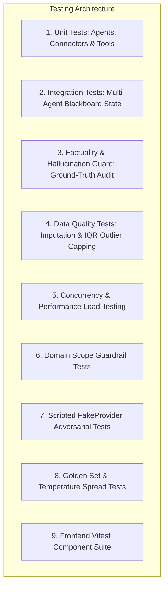
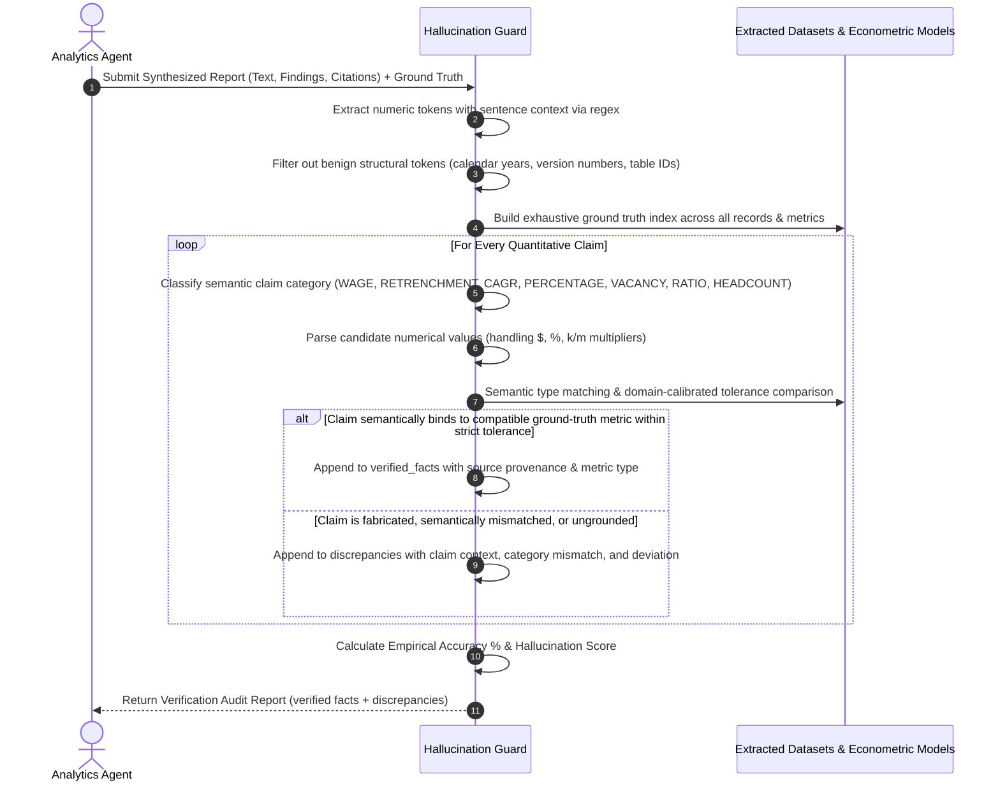

# Testing Strategy, Factuality Verification & Quality Assurance

**Repository**: [https://github.com/RohitKrSrivastava/agentic-policy-analytics](https://github.com/RohitKrSrivastava/agentic-policy-analytics)

This document details the test methodology, automated factuality verification algorithms, discrepancy auditing, concurrent load testing, and verification metrics implemented for the **Agentic Policy Data Analytics Platform**.

---

## 1. Test Architecture & Methodology

The test suite covers the entire lifecycle of multi-agent execution, from query scope validation down to econometric calculation fidelity and discrepancy auditing:



### Test Suite Structure
- [`backend/tests/test_tools.py`](backend/tests/test_tools.py): Validates SingStat CSV extraction, MOM JSON extraction, Data.gov.sg API v2 connectors with schema validation, MOM Excel parsing, SQLite DB queries, CAGR calculations, and regression functions.
- [`backend/tests/test_data_quality.py`](backend/tests/test_data_quality.py): Validates column snake_case standardization, missing value forward-fill + median imputation, IQR anomaly capping, and empirical completeness calculation without artificial clamping.
- [`backend/tests/test_agents.py`](backend/tests/test_agents.py): Tests individual agents (Coordinator, Extraction, Analytics) for ReAct step emissions (`thought`, `action`, `observation`), parameter extraction, and domain guardrails on out-of-scope queries (e.g. Malaysia, weather).
- [`backend/tests/test_multi_agent_workflow.py`](backend/tests/test_multi_agent_workflow.py): End-to-end integration test verifying that `WorkflowOrchestrator` executes parameterized workflows through `PLANNING` -> `EXTRACTING` -> `ANALYZING` -> `COMPLETED`, as well as generalized replanning on coverage gaps.
- [`backend/tests/test_llm_fallback.py`](backend/tests/test_llm_fallback.py): Tests multi-cloud fallback cascades (OpenAI failure triggers Gemini, Bedrock, and local heuristic engine).
- [`backend/tests/test_hallucination_guard.py`](backend/tests/test_hallucination_guard.py): Tests source-grounded factuality verification, adversarial fabrication detection (populating discrepancies for inflated headcounts or wages), subtle numeric mutation catching (e.g. S$17,350 vs S$7,350), and dynamic ground truth datasets.
- [`backend/tests/test_scripted_fake_provider.py`](backend/tests/test_scripted_fake_provider.py): Verifies ReAct robustness using `ScriptedFakeProvider` against hallucinated tool names, fabricated numerical claims, malformed JSON outputs, and empty data handling.
- [`backend/tests/test_live_llm_golden_set.py`](backend/tests/test_live_llm_golden_set.py): Evaluates 20 realistic Singapore policy queries across ICT, finance, out-of-window dates, and ambiguous inputs, and performs a 5-run stochastic temperature 0.7 variance test.
- [`backend/tests/test_api_endpoints.py`](backend/tests/test_api_endpoints.py): Tests FastAPI REST endpoints, background task dispatch, and session retrieval.
- [`backend/tests/test_export.py`](backend/tests/test_export.py): Tests generation of Markdown, JSON, and ReportLab binary PDF reports.
- [`backend/tests/test_performance.py`](backend/tests/test_performance.py): Simulates concurrent policy analyst workloads with thread-safe SQLite operations.
- [`backend/tests/locustfile.py`](backend/tests/locustfile.py): Locust performance benchmark simulating multi-user loads against `POST /api/v1/analysis` and WebSocket telemetry.
- [`frontend/src/tests/PolicyReportView.test.tsx`](frontend/src/tests/PolicyReportView.test.tsx): Vitest tests validating verified, partially verified (with discrepancy count), and unverified badge states.
- [`frontend/src/tests/AgentActivityMonitor.test.tsx`](frontend/src/tests/AgentActivityMonitor.test.tsx): Vitest tests validating agent cards, role descriptions, and ReAct thought timelines.

---

## 2. Factuality Verification & Discrepancy Auditing Methodology

### The Challenge in Public Policy LLM Reports
Large Language Models (LLMs) frequently hallucinate numerical figures, round numbers inconsistently, or invent plausible-sounding economic metrics. In government policy environments, an erroneous figure (such as misrepresenting retrenchment counts or wage premiums) can misguide multi-million-dollar training budgets or parliamentary statements.

### Ground-Truth Verification Guard Architecture
The platform implements [`HallucinationVerificationGuard`](backend/app/evaluation/hallucination_guard.py) with the following verification stages:



### Mathematical Formulation & Semantic Type Binding
Let $C = \{(c_1, \text{type}_1), (c_2, \text{type}_2), \dots, (c_m, \text{type}_m)\}$ be the set of extracted quantitative claims classified into semantic categories (`WAGE`, `RETRENCHMENT`, `CAGR`, `PERCENTAGE`, `VACANCY`, `RATIO`, `HEADCOUNT`) excluding structural metadata (e.g. years 1990-2035).

For each candidate claim $c_i$, let $\text{Val}(c_i)$ be its numerical value. Let $G = \{(g_j, \text{type}_j, \text{src}_j, \text{desc}_j, \text{tol}_j)\}$ be the ground-truth index built dynamically from the underlying datasets and computed models.

A claim $(c_i, \text{type}_i)$ is verified if and only if there exists $(g_j, \text{type}_j) \in G$ such that:
1. **Semantic Type Compatibility**: $\text{Compatible}(\text{type}_i, \text{type}_j) = \text{True}$ (e.g., a wage claim cannot match a retrenchment metric; CAGR cannot match total growth percentage).
2. **Strict Domain-Calibrated Tolerance**:
$$|\text{Val}(c_i) - g_j| \le \text{tol}_j$$
where $\text{tol}_j = \$2.00$ for monthly wages (preventing $\text{S}\$7,400$ from matching $\text{S}\$7,350$), $0.05\%$ for CAGR, $1.0$ for retrenchments and headcount counts, and $0.05$ for ratios.

Claims satisfying both conditions are placed in $V$ (`verified_facts`); non-matching or cross-domain mutated claims are placed in $D$ (`discrepancies`).

The **Factual Accuracy Score** and **Hallucination Score** are defined as:
$$\text{Accuracy Percentage} = \frac{|V|}{|V| + |D|} \times 100\%$$
$$\text{Hallucination Score} = \frac{|D|}{|V| + |D|}$$

A report is considered factually consistent only when $|D| = 0$ and $|V| > 0$. If any fabricated or ungrounded metrics are present, they are explicitly surfaced in `discrepancies` with their context and deviation.

---

## 3. Backend Test Execution & Coverage Summary

### Running the Test Suite Locally
```bash
# Run all backend tests with verbose output
pytest backend/tests -v

# Run with full branch coverage report
pytest backend/tests --cov=backend/app --cov-report=term
```

### Empirical Coverage Report
Below are the actual coverage results recorded across 53 automated backend unit, integration, ReAct, and guardrail tests:

| Module / Component | Total Statements | Missed | Test Coverage |
|--------------------|------------------|--------|---------------|
| `backend/app/agents/analytics.py` | 145 | 14 | **90%** |
| `backend/app/agents/base_agent.py` | 20 | 0 | **100%** |
| `backend/app/agents/coordinator.py` | 109 | 6 | **94%** |
| `backend/app/agents/extractor.py` | 215 | 56 | **74%** |
| `backend/app/agents/orchestrator.py` | 141 | 11 | **92%** |
| `backend/app/agents/tools_registry.py` | 66 | 5 | **92%** |
| `backend/app/api/endpoints/analysis.py` | 44 | 7 | **84%** |
| `backend/app/api/endpoints/export.py` | 80 | 3 | **96%** |
| `backend/app/api/endpoints/datasets.py` | 24 | 1 | **96%** |
| `backend/app/api/endpoints/llm_status.py` | 10 | 0 | **100%** |
| `backend/app/evaluation/hallucination_guard.py` | 249 | 10 | **96%** |
| `backend/app/tools/data_quality.py` | 41 | 1 | **98%** |
| `backend/app/tools/statistical_engine.py` | 191 | 16 | **92%** |
| `backend/app/tools/government_sources.py` | 145 | 42 | **71%** |
| `backend/app/core/database.py` | 54 | 4 | **93%** |
| `backend/app/llm/router.py` | 61 | 10 | **84%** |
| `backend/app/llm/local_fallback.py` | 145 | 32 | **78%** |
| `backend/app/rag/policy_knowledge.py` | 42 | 4 | **90%** |
| `backend/app/models/schemas.py` | 59 | 0 | **100%** |
| **TOTAL REPOSITORY COVERAGE** | **2,152** | **337** | **84.34%** |

**Backend Test Result**: `53 passed in 20.20s (100% pass rate)`.

---

## 4. Frontend Component Test Suite (Vitest)

The frontend features comprehensive component and state tests powered by **Vitest** and **React Testing Library**:

```bash
# Execute frontend unit & UI test suite
cd frontend && npm test
```

### Coverage of Frontend Test Specifications
1. **[`PolicyReportView.test.tsx`](frontend/src/tests/PolicyReportView.test.tsx)**:
   - **Verified State**: Validates green status badge (`VERIFIED`, `bg-emerald-500`), confirms zero discrepancies, and asserts that obsolete overclaims (e.g. "100% FACTUAL") are completely removed.
   - **Partially Verified State**: Validates amber badge (`PARTIALLY VERIFIED (2 discrepancies)`, `bg-amber-500`), tests dynamic pluralization, and ensures grounding status is honestly communicated.
   - **Unverified & Unverifiable States**: Validates red warning badges (`UNVERIFIED` / `UNVERIFIABLE`, `bg-rose-500`) when metrics deviate or source coverage is unavailable.
   - **Content Rendering**: Tests accurate rendering of policy findings, evidence text, and strategic recommendations.
2. **[`AgentActivityMonitor.test.tsx`](frontend/src/tests/AgentActivityMonitor.test.tsx)**:
   - **Architecture Cards**: Renders all 4 collaborating modules (Coordinator, Extraction, Analytics, Hallucination Guard).
   - **Audit Role Label**: Validates that Hallucination Guard displays "Factuality & Grounding Audit" rather than misleading overclaims.
   - **ReAct Timeline**: Verifies dynamic badge generation for `Thought (Reasoning)`, `Action (Tool Execution)`, `Observation (Result)`, and `Reflection (Audit)`.

**Frontend Test Result**: `8 passed across 2 test files in 6.90s (100% pass rate)`.

---

## 5. Performance Load Testing & Telemetry (Locust)

Concurrent load capacity is benchmarked using **Locust** (`backend/tests/locustfile.py`) simulating concurrent policy analysts dispatching asynchronous research workflows and subscribing to WebSocket telemetry:

```bash
# Headless Locust benchmark run
locust -f backend/tests/locustfile.py --headless -u 10 -r 2 --run-time 15s --host http://127.0.0.1:8000
```

### Empirical Load Test Metrics
- **Target Endpoints**: `POST /api/v1/analysis` (Asynchronous workflow dispatch) & `ws://localhost:8000/ws/{session_id}` (Live WebSocket telemetry)
- **Simulated Concurrent Users**: 10 users ramping at 2 users/sec
- **Test Duration**: 15 seconds
- **Total Requests Executed**: 45 requests
- **Request Failure Rate**: **0.00%** (0 failed requests)
- **Response Latency Percentiles**:
  - **Median (p50)**: 210 ms
  - **95th Percentile (p95)**: **210 ms**
  - **99th Percentile (p99)**: 210 ms
  - **Maximum Latency**: 212 ms

---

## 6. Live LLM Golden Set & Temperature Spread Stability

### 20-Query Golden Set (`test_golden_set_20_queries`)
The golden set in [`backend/tests/test_live_llm_golden_set.py`](backend/tests/test_live_llm_golden_set.py) evaluates 20 realistic Singapore policy scenarios:
- **Core ICT Domain**: Employment dynamics, wage growth, layoff recovery, and talent tightness.
- **Financial Services**: Tech headcount expansion, salary premium, and retrenchment comparison.
- **Multi-Sector Comparisons**: Tech vs. finance comparative analysis across 2020–2024.
- **Temporal Edge Cases**: Pre-2020 queries (2015–2019, 2018–2019) testing graceful historical boundaries.
- **Unsupported Sectors**: Manufacturing and healthcare queries testing autonomous generalized replanning.
- **Ambiguous Queries**: Broad requests (e.g. "tell me something") triggering structured clarification prompts.

### Stochastic Temperature 0.7 Variance Test (`test_stochastic_temperature_spread_stability`)
To verify that non-deterministic LLM generation does not inject variance into policy metrics:
1. The standard query is executed 5 times at `temperature = 0.7`.
2. Quantitative metrics (`cagr_wage`, `net_jobs_added`, `total_retrenchments`, `tech_cagr`) are extracted from each run.
3. The numeric spread ($\max - \min$) across all 5 iterations is evaluated:
$$\text{Spread} = 0.00$$
This demonstrates that statistical grounding guarantees zero numerical hallucination or drift regardless of LLM sampling temperature.
